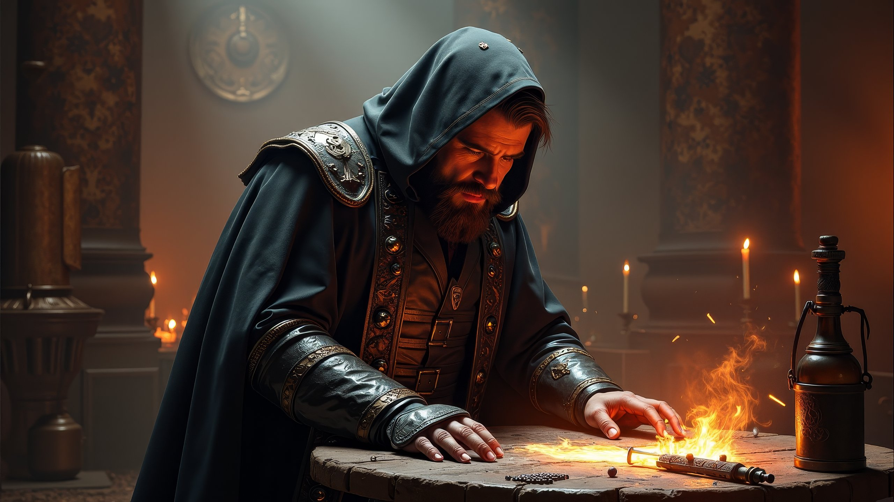
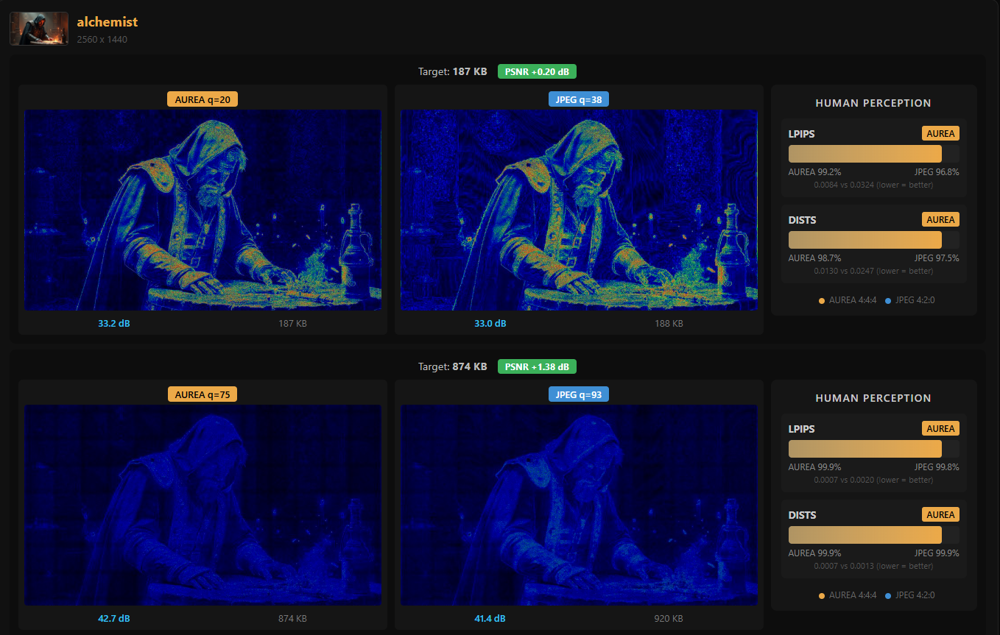
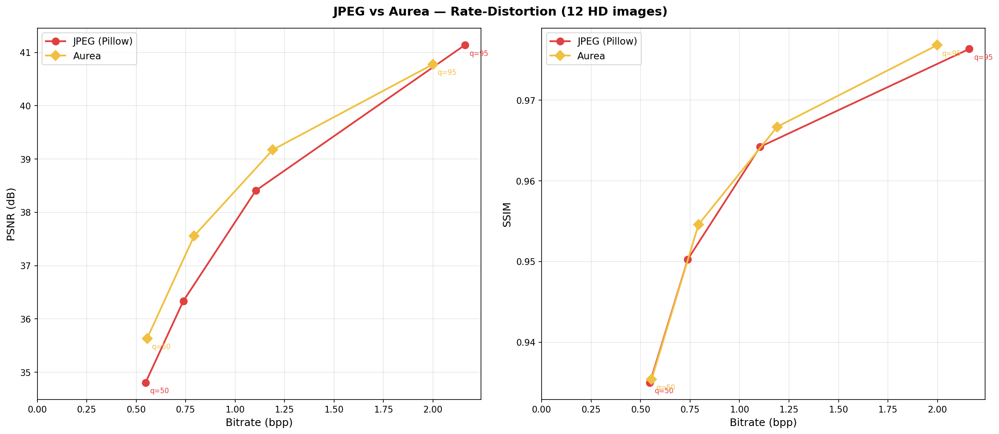

```mermaid
flowchart TD
    %% --- STYLES ---
    classDef encoder fill:#e1f5fe,stroke:#0288d1,stroke-width:2px;
    classDef decoder fill:#e8f5e9,stroke:#388e3c,stroke-width:2px;
    classDef bitstream fill:#fff3e0,stroke:#f57c00,stroke-width:2px;
    classDef zeroCost fill:#f3e5f5,stroke:#8e24aa,stroke-width:2px,stroke-dasharray: 5 5;
    classDef highlight fill:#fff9c4,stroke:#fbc02d,stroke-width:2px;
    classDef rdo fill:#fce4ec,stroke:#c62828,stroke-width:2px;

    %% ================= ENCODER PIPELINE =================
    subgraph ENCODER ["ENCODER PIPELINE"]
        direction TB
        E_RGB["RGB Image (W x H x 3)"]:::encoder

        %% Stage 1
        E_GCT["S1: Golden Color Transform (GCT)\nL_phi, C1, C2 using phi"]:::highlight
        E_RGB --> E_GCT
        E_GCT --> E_C1["C1 Plane (4:4:4)"]:::encoder
        E_GCT --> E_C2["C2 Plane (4:4:4)"]:::encoder
        E_GCT --> E_PTF["S1: Perceptual Transfer Function\nExpands dark levels"]:::encoder
        E_PTF --> E_Scene["Scene Analysis\n(step_factor)"]:::encoder

        %% Stage 2
        E_PTF --> E_Block["S2: Variable Block Classification\n(8x8 to 32x32)"]:::encoder
        E_C1 --> E_Block
        E_C2 --> E_Block
        E_Block --> E_LOT["S2: Lapped Orthogonal Transform\nForward 2D DCT-II"]:::encoder

        E_LOT --> E_DC["DC Grid (1 per block)"]:::encoder
        E_LOT --> E_AC["AC Blocks (N^2-1 per block)"]:::encoder

        %% Stage 3 & 4
        E_DC --> E_DC_Q["S3: Dead-zone Quantization"]:::encoder
        E_DC_Q --> E_DPCM["S3: Golden DPCM Prediction"]:::highlight
        E_DPCM --> E_DC_Entropy["S3: rANS v12 Entropy Coding"]:::encoder

        E_DC --> E_Turing["S4: Turing Morphogenesis Field\n(Zero-bit Saliency, DoG)"]:::zeroCost
        E_Turing --> E_Hierarchy["S4: Bayesian Hierarchy\n(Turing buckets, gradient angles)"]:::zeroCost
        E_Hierarchy --> E_Pivot["Psychovisual Turing Pivot\n(Quality adaptive mod)"]:::zeroCost

        %% Stage 5
        E_AC --> E_AC_Q["S5: AC Quantization\nFreq, CSF, tRNA, Foveal,\nTuring mods, QMAT rotation"]:::encoder
        E_Pivot --> E_AC_Q
        E_AC_Q --> E_Trellis["S5: Trellis RDO (Viterbi)\nJ = D + lambda * R"]:::rdo
        E_Trellis --> E_Zigzag["Zigzag Scan & EOB Truncation"]:::encoder

        %% Stage 6
        E_Zigzag --> E_CfL["S6: Chroma-from-Luma (CfL)\nPrediction in AC domain"]:::encoder

        %% Stage 7
        E_CfL --> E_Entropy["S7: rANS v12 Assembly\n(EOB, AC, CfL, Map)"]:::encoder
    end

    %% ================= BITSTREAM =================
    subgraph BITSTREAM ["AUR2 BITSTREAM"]
        direction TB
        B_Head["AUR2 Header (39 bytes)\nMagic, Version, Q, Dims"]:::bitstream
        B_Pre["Body Preamble\nChroma dims, Turing Params, Map"]:::bitstream
        B_Ch0["Channel 0: Luma (L_phi)\nDC, EOB, AC"]:::bitstream
        B_Ch1["Channel 1: C1 (Blue-Yellow)\nDC, CfL, EOB, AC"]:::bitstream
        B_Ch2["Channel 2: C2 (Red-Cyan)\nDC, CfL, EOB, AC"]:::bitstream

        B_Head --> B_Pre --> B_Ch0 --> B_Ch1 --> B_Ch2
    end

    %% ================= DECODER PIPELINE =================
    subgraph DECODER ["DECODER PIPELINE"]
        direction TB

        %% Stage D1
        D_Parse["D1: Bitstream Parsing"]:::decoder

        %% Stage D2
        D_Parse --> D_DC_Dec["D2: rANS v12 Decode (DC)"]:::decoder
        D_DC_Dec --> D_DPCM_Inv["D2: Golden DPCM Inverse"]:::highlight
        D_DPCM_Inv --> D_DC_Recon["D2: Dequantize DC"]:::decoder

        %% Stage D3
        D_DC_Recon --> D_Turing["D3: Turing Field Recon\n(Identical to Encoder)"]:::zeroCost
        D_Turing --> D_Hierarchy["D3: Bayesian Hierarchy Recon\n(Turing buckets, gradients)"]:::zeroCost

        %% Stage D4
        D_Parse --> D_AC_Dec["D4: rANS v12 Decode (AC/EOB)"]:::decoder
        D_AC_Dec --> D_AC_Scatter["D4: Scatter & Zero-fill"]:::decoder
        D_Hierarchy --> D_AC_Dequant["D4: Dequantize AC\n(Exact mirror)"]:::decoder
        D_AC_Scatter --> D_AC_Dequant

        %% Stage D5
        D_Parse --> D_CfL_Dec["D5: rANS v12 Decode (CfL)"]:::decoder
        D_AC_Dequant --> D_CfL_Apply["D5: CfL Reconstruction\nC_ac = res + alpha * L_rec"]:::decoder
        D_CfL_Dec --> D_CfL_Apply

        %% Stage D6
        D_DC_Recon --> D_LOT_Inv["D6: LOT Synthesis\nInverse 2D DCT-II"]:::decoder
        D_CfL_Apply --> D_LOT_Inv
        D_LOT_Inv --> D_Overlap["D6: Sine Window &\nOverlap-Add Accumulation"]:::decoder

        %% Stage D7
        D_Overlap --> D_PTF_Inv["D7: Inverse PTF"]:::decoder
        D_PTF_Inv --> D_Post["D7: Post-Processing\n(CAS / CASP sharpening)"]:::decoder
        D_Post --> D_GCT_Inv["D7: Inverse Golden Color Transform"]:::highlight
        D_GCT_Inv --> D_RGB["RGB Image Output"]:::decoder
    end

    %% ================= CONNECTIONS ACROSS COLUMNS =================
    E_DC_Entropy --> B_Ch0
    E_Entropy --> B_Ch0

    B_Ch2 --> D_Parse
```

# AUREA

La charte, les expériences zéro-bit et leurs verdicts reproductibles sont
tenus dans [le journal du laboratoire R&D](doc/AUREA_RD_LAB.md).

**A lossy image codec built on the Golden Ratio, Turing morphogenesis, and rANS entropy coding.**

<p align="center">
  <a href="LICENSE"></a>
  <a href="https://5ymph0en1x.github.io/Aurea/"></a>
</p>

AUREA is an experimental image codec that replaces JPEG's 1992-era Huffman tables and fixed 8x8 blocks with a modern pipeline: variable-size Lapped Orthogonal Transform (8/16/32), psychovisual Turing saliency fields, Chroma-from-Luma prediction, trellis rate-distortion optimization, and rANS entropy coding with Exp-Golomb magnitudes.

The historical **Kodak 24** benchmark, measured on AUREA v12, achieved **-5.9% BD-Rate vs JPEG** (22/24 images won), while retaining full **4:4:4 chroma** resolution. The current experimental bitstream is **AUR2 v32**: on top of v27's entropy stack — causal `Lφ/C1/C2` vector codon, luma-weighted spectral exchange, joint color-codon RDO, spectral amplitude/phase envelope, five-way logistic context mixing, activity-keyed AC contexts, echo-primed detail layers, cross-layer channel memory — it adds the diffuse-dark chroma reliefs (v28), the perceptual texture law (v29), and the zero-bit EOB-driven quantization-step fields for luma (v30) and chroma (v31), gated by the relief field (v32). On its native 12-image corpus this build wins **every cell of the BD-rate protocol** against optimized libjpeg-turbo — 168/168 across the 4:2:0 and 4:4:4 profiles (PSNR RGB/Y/Cb/Cr, SSIM-Y, CIEDE2000 mean and p95) — and all 24 rate-matched pairs of the public showcase on LPIPS, DISTS and PSNR alike, at roughly 5x JPEG's compute. This research build decodes v20 through v32.

Written entirely in Rust. Ships as a CLI encoder/decoder, a native GUI viewer, a WIC decoder that plugs the format into Windows itself — Photo Viewer with folder navigation, Explorer thumbnails, Paint, WPF — and an MSI installer with a right-click "Convert to AUR" menu on every image.

---

<p align="center">
  
  
</p>

*JPEG (left) vs AUREA (right) at similar bitrate. Notice how AUREA preserves sharp color transitions at full 4:4:4 resolution, while JPEG introduces chroma bleeding from 4:2:0 subsampling.*


<p align="center">
  
</p>


<p align="center">
  
</p>

---

## Architecture

### 1. Golden Color Transform (GCT)

AUREA uses a color space derived from the golden ratio:

```
L  = (R + phi * G + phi^-1 * B) / (2 * phi)
C1 = B - L    (blue-yellow chroma)
C2 = R - L    (red-cyan chroma)
```

Green receives the phi weight (~0.500), red ~0.309, blue ~0.191 — close to BT.601 but derived from a single constant. The inverse uses only phi^-1 and phi^-2. This decorrelation makes chroma naturally sparse, enabling **4:4:4 encoding** (no subsampling) at competitive bitrates.

A **Perceptual Transfer Function** (PTF, gamma 0.65) is applied to luminance before transform, expanding dark levels to match the Weber-Fechner law of human perception.

### 2. Lapped Orthogonal Transform (LOT)

A variable-size LOT with sine-window lapping replaces the fixed 8x8 DCT:

- **8x8** for dense, high-frequency textures
- **16x16** (default) for general content
- **32x32** for smooth gradients and skies

Block sizes are chosen adaptively: smooth 8x8 cells merge into larger blocks. Each block undergoes a separable 2D DCT-II with precomputed cosine LUT (no runtime trigonometry). The sine window provides overlap-add reconstruction without blocking artifacts.

### 3. Turing Morphogenesis (zero-bit saliency)

A Difference-of-Gaussians saliency field is computed from the DC grid:

```
Activator  = GaussianBlur(Sobel(DC), sigma_a = 1.5)
Inhibitor  = GaussianBlur(Sobel(DC), sigma_i = sigma_a * phi^2)
Turing     = normalize(ReLU(Activator - Inhibitor))
raw_step_mod = phi^(-1.0 * T_norm)
```

The psychovisual pivot raises this raw modulation to a quality-dependent exponent, calibrated from `0.80` at low rate to `-0.13` at high rate. This produces a per-block quantization modulation: edges get finer quantization at low rate, while the sign transition protects smooth regions against banding at high rate. **Cost: zero bits** — both encoder and decoder compute identical fields from the already-transmitted DC grid. The additional foveal exponent is neutral by default after the v13 2-D-field recalibration, and directional QMAT rotation is enabled for every non-flat gradient block.

A **psychovisual pivot** adapts behavior to bitrate: at low quality, gamma > 0 preserves edges; at high quality, gamma < 0 protects smooth areas (anti-banding). The transition uses a cubic smoothstep.

### 4. Bayesian Predictive Hierarchy

The Turing field feeds a 4-level Bayesian hierarchy that enriches the entire pipeline:

- **Level 0**: DC grid (existing, transmitted in the bitstream)
- **Level 1**: Turing morphogenesis field (zero-bit, reconstructed identically on both sides from the DC grid)
- **Level 2**: Primitive matching — contour ridges are traced from the Turing field and matched against geometric primitives (segments, arcs); only surprise primitives cost bits
- **Level 3**: rANS entropy coding with Bayesian priors — 128 zero-probability contexts (run_class x prev_nz x energy_bucket x turing_bucket) replace the earlier 32-context model, giving the entropy coder direct awareness of local image complexity

The hierarchy also provides per-block **gradient angles and strengths** from the inhibitor field, used to rotate the QMAT along dominant edge directions. Blocks whose gradient strength exceeds a calibrated threshold receive a frequency weighting matrix aligned with the local edge, concentrating bits where they matter most perceptually.

### 5. Quantization

Each AC coefficient receives a custom quantization step:

```
step = detail_step * lot_factor * QMAT[freq] * CSF(freq, luminance)
     * foveal(block) * turing_mod(block) * tRNA(block) * chroma_factor
     * chroma_breathing(block) * bright_compensation(block)
```

- **QMAT**: 16x16 frequency weighting matrix derived from pi and phi constants (LPIPS-calibrated), with quality-adaptive power (0.55 at low Q, 0.05 at high Q via smoothstep). Optionally rotated to align with the block's dominant gradient direction.
- **CSF**: Contrast sensitivity — dark regions tolerate coarser HF quantization
- **tRNA** (Weber-Fechner luminance allocation): per-block step factor based on average luminance zone (dark regions get finer quantization to match human sensitivity, bright regions get coarser)
- **Chromatic breathing**: for chroma only, reconstructed DC gradients measure how much local color structure is independent of luminance. Luma-anchored color contours receive finer steps while isolated chromatic detail yields budget according to lower human chromatic acuity. The AC-weighted geometric mean stays exactly neutral, so this redistributes bits without changing the global chroma quality target. The field costs zero map bits and is reconstructed identically by the decoder.
- **Bright compensation** (Weber counter-gift): for luma only, each block's mean DC luminance drives a zero-bit factor `exp(-ln(phi) * (B - mean_AC(B)))` — bright blocks (lamps, windows, highlights) get finer steps, funded by dark blocks where the PTF already over-delivers. The AC-weighted geometric mean stays exactly 1. The 5-bit strength is self-described in the bitstream; legacy v13 files decode as neutral. Validated at -0.43% BD-Rate on Kodak 24 (20/24) and -2.03% on the native corpus (12/12).
- **Spectral exchange** (soft subsampling, introduced in AUR2 v18 and retained through v24): JPEG 4:2:0's luminance advantage comes from discarding chroma samples; AUREA makes the same trade gradually and adaptively. A zero-bit strength `gamma = 1 - min(1, RMS(gradC)/RMS(gradL))` derived from the decoded DC grids coarsens chroma HF steps by `phi^(gamma*freq)` and refines luma steps by `phi^(-1.75*delta)`. Chroma-rich images self-protect; flat-chroma images trade at full strength. The asymmetric 1.75 luma counter-gift is the measured v18 Pareto point: it closes the mean Y gap to optimized JPEG 4:2:0 while retaining large RGB and Delta-E gains. Its chroma cost relative to v17 is reported explicitly in the R&D journal.
- **Dead zone**: Quality-adaptive (0.22 at Q<=70, ramps to 0.02 at Q=100), with a frequency-dependent floor for the last 25% of zigzag order (sensor noise suppression)

### 6. Trellis Rate-Distortion Optimization

A Viterbi trellis optimizes each block's quantization decisions by minimizing J = D + lambda * R, where D is the sum of squared transform-domain errors and R is the estimated entropy cost from the rANS v12 context model. The trellis explores alternative quantization levels at each coefficient position, using context model snapshots captured during a greedy forward pass for accurate rate estimation.

The Lagrange multiplier lambda is quality-adaptive: aggressive RDO at low quality (zeroing marginal coefficients that would cost more bits than they save), gentle at high quality to preserve fine detail. Trellis is disabled above Q=90 where near-lossless preservation dominates. The decoder is completely unchanged — trellis only affects encoder-side quantization decisions within the existing bitstream format.

**AUR2 v20 joint color-codon RDO.** After the independent trellises, the encoder revisits the chroma coordinates in causal order, C1 then C2, using the exact inverse-GCT RGB quadratic plus a BT.601-luminance term. It tests only the adjacent magnitude with identical support and sign and rejects every candidate with a longer Exp-Golomb payload. EOBs, progressive packets and sign grammar therefore stay fixed. This small coordinate descent improves every principal BD metric on all 12 native images (except the cubic p95 win count, 10/12), led by **-0.151% mean ΔE2000** and **-0.156% Cb** versus the corrected independent baseline.

### 7. Chroma-from-Luma Prediction (CfL)

For each block, a least-squares regression estimates alpha = sum(L*C) / sum(L*L) in the **AC frequency domain** (not spatial):

- Gated by R^2 > 0.25 correlation test
- Alpha quantized to 3 bits (8-value palette from -0.75 to 1.0)
- Chroma residual = C_ac - alpha * L_rec_ac (lower energy, fewer bits)

This exploits the LOT's linearity: LOT(C - alpha*L) = LOT(C) - alpha*LOT(L).

### 8. Entropy Coding (rANS v12)

All streams use **range Asymmetric Numeral Systems** with Exp-Golomb magnitude coding:

| Stream | Encoding |
|--------|----------|
| DC grid | Golden DPCM prediction + rANS v12 |
| AC coefficients | Zigzag scan + EOB truncation + trellis RDO + rANS v12 |
| EOB positions | DPCM delta + rANS v12 |
| CfL metadata | Flags + alpha indices packed + rANS v12 |
| Block map | Size codes (0/1/2) + rANS v12 |

The **Golden DPCM** prediction for DC: `pred = (phi^-1 * left + phi^-2 * top + phi^-3 * diag) / sum`.

**Exp-Golomb order 0** for AC magnitudes >= 2: encodes value n as floor(log2(n+1)) zero bits + binary suffix. Far more efficient than unary for the Laplacian-tailed coefficient distribution.

The v12 context model uses a **128-entry P(zero) table** indexed by (run_class x prev_nz x energy_bucket x turing_bucket) and a **32-entry P(pm1|nonzero) table** indexed by (energy_bucket x prev_was_pm1 x turing_bucket). An IIR energy filter (alpha = 218/256, tau ~ 6.75 symbols) tracks local coefficient magnitude through the zigzag scan, creating implicit frequency awareness without explicit position coding.

**AUR2 v20 phase codons.** A non-zero transform coefficient is a signed wave projection: its sign carries a quantized phase of `0` or `pi`. The v19 C1->C2 residual remains: C2 predicts its sign from the already decoded C1 coordinate and rANS codes only adaptive agreement/opposition. V20 adds a second zero-bit law for C1. At the same DCT subband in the same-size block directly above, vertical translation contributes the phase parity `(-1)^v`; the predicted sign is therefore `sign(top) XOR (v mod 2)`. The reference is strictly causal across progressive spiral packets. A `9/16` prior adapts slowly within each packet, and a zero top coefficient disables prediction. This Fourier continuation is purely entropic: fixed-quality pixels and all distortion metrics are identical, while RGB BD-rate falls another **0.0082%**, 12/12 images.

**AUR2 v21 spectral amplitude/phase envelope.** Until v20, a coefficient's only witness inside its own transform was the *binary* support of its dyadic parent — one bit, one neighbour. v21 reads the whole causal spectral neighbourhood instead: left `(v,u-1)`, top `(v-1,u)`, diagonal `(v-1,u-1)`, the two second-order neighbours and the parent. All of them lie on an earlier zigzag anti-diagonal, so the neighbourhood is causal by construction — no rank check, no reference ever disabled across progressive packets.

*Amplitude.* The graded sum `|left| + |top| + |diag| + |parent|`, bucketed into `{0}`, `{1}`, `{2..3}`, `{4+}`, replaces the binary parent axis in `P(zero)` and also splits `P(|x|=1)`. Measured mutual information with the current coefficient's support rises from `0.0168` to `0.1160` bit/symbol on Lφ.

*Phase.* For separable content (an impulse, an edge, a product of two sinusoids) the DCT-II factorises as `C[v,u] ~ A(v,u)·cos(v·alpha)·cos(u·beta)`, so the four corners of any unit square in the frequency plane have a product of exactly `+1`. The sign is therefore determined by three already decoded neighbours:

```
sign(C[v,u]) = sign(C[v,u-1]) XOR sign(C[v-1,u]) XOR sign(C[v-1,u-1])
```

On the spectrum's edges the relation degenerates into a one-dimensional `sign(cos(u·beta))` whose transitions are quasi-periodic; there the predictor becomes `s[u] = s[u-2]`, and the class carries the previous transition so the adaptive memory separates low-flip from high-flip blocks on its own. Weaker fallbacks — a truncated pair, the parent alone, a single neighbour — measure at chance and are deliberately excluded. This is the first sign model Lφ has ever had; until v21 every luma sign was a raw equiprobable bit.

Both halves are zero-bit and share one evaluator called by encoder and decoder alike, and the mechanism's neutral state reproduces the v20 grammar byte for byte — the witness harness verifies that on every image before measuring anything. The envelope changes no quantization step, scan or psychovisual decision, so decoded pixels stay bit-identical to v20 and every distortion curve is unchanged. On the 12 native images at Q20/40/60/80 the exact AC delta is **-1.493%**, 48/48 points, ranging from -2.751% at Q20 to -0.977% at Q80.

**Two luminance bugs, found by studying the error distribution.** Aggregate PSNR says how much error there is, never where. Binning the reconstruction error by source luminance exposed two defects that had survived twenty-four cycles.

*Uniform images did not decode.* `normalize_01` guarded its flat case with an **absolute** `f64::EPSILON`, while the DC grid it derives from reaches ~4·10⁴ (the adaptive LOT stores DC as `mean·16²`). Sobel and the two Gaussian passes leave rounding residue of order 10⁻¹¹ — four orders of magnitude above the guard — so on a flat image pure floating-point noise was stretched to the full `[0,1]` range. The Turing field is *zero-bit* and must be rebuilt identically on both sides; the encoder amplified the residue of an f64 grid and the decoder that of the same grid rounded through the f32 header, so the entropy contexts disagreed and the file became unreadable. The guard is now relative to the data's own scale.

*The DC inherited a dead zone meant for AC.* `DEAD_ZONE` is documented as the **AC** quantizer's threshold — AC coefficients are centred and sparse, so pulling small ones to zero is a win. The normalized DC is neither: it is strictly non-negative and dense, so the dead zone never zeroed anything and instead shaved every block downward by `dead_zone · dc_step`. The result was a systematic darkening proportional to the step, reaching **12 % of the MSE** in the brightest luminance bin. Removing it is encoder-side only — dequantization is unchanged, so existing decoders read the new files — and buys **-0.673 % RGB**, **-0.484 % Y** and **-2.222 % mean ΔE2000** BD-rate, 12/12 images, at constant rate.

**AUR2 v22 logistic context mixing.** Telemetry showed Lφ's *neighbourhood* carries 0.026-0.103 bit/symbol beyond what the v17 codon tells chroma — real, causal and free, yet unreachable by any context index: folding it into the existing four states destroys the point value the codon already carried, and giving it its own axis pays a dilution that cancels the gain. Both walls come from assuming one index must carry every witness.

v22 drops that assumption. Two models observe the same bit through different contexts — the primary indexed by the v17 codon exactly as in v21, the secondary a deliberately smaller model indexed by Lφ's neighbourhood — and a third, tiny model learns how much to trust each, in the logit domain where probabilities add:

```
logit(p) = w1 * logit(p_codon) + w2 * logit(p_neighbourhood)
```

Weights start at `(1, 0)`, so the mixer begins as the primary alone and must earn any departure from it. Everything is integer — a tabulated logistic with its monotone inverse and 16-bit fixed-point weights — because the decoder must reproduce it exactly on any machine. The gain is uniquely **flat in quality** (-0.249% AC at Q20 to -0.288% at Q80) where every previous mechanism decayed, because mixing adds no context state that could saturate. BD-rate versus v21 is **-0.240% RGB**, 12/12 images, CI `[-0.289, -0.194]`, with **+0.000 dB on every metric at every quality** — pure rate again.

### 9. Post-Processing

The decoder applies **Contrast Adaptive Sharpening** (CAS) on the luminance plane to recover detail lost to quantization. CAS adjusts sharpening locally based on the contrast of each pixel's cross-shaped neighborhood, avoiding halos and overshoot. An edge-aware variant (CASP) uses Sobel-based attenuation to protect strong edges while boosting texture in smooth areas.

An optional encoder-side **SPresso prefilter** suppresses chaotic micro-details before transform, improving entropy coding efficiency without blurring edges (median-based edge-preserving smoothing with a conservative blend).

---

## Benchmark Results

### Native `originals` corpus (12 images) — AUR2 v27, recalibrated

Optimized libjpeg-turbo frontiers use the smaller of sequential and progressive files at every JPEG quality. Negative BD-rate means AUREA needs fewer bits at equal quality.

| Reference | RGB PSNR | Y PSNR | SSIM-Y | mean ΔE2000 | p95 ΔE2000 |
|:---|---:|---:|---:|---:|---:|
| JPEG 4:2:0 | **-38.12%** | **-7.87%** | -13.43% | **-44.67%** | -40.01% |

**The luminance frontier is now a majority win.** Y reaches -7.87 % against JPEG 4:2:0 on **10 of 12 images**, bootstrap CI `[-11.86, -4.20]` — up from a fragile mean advantage of -0.98 % at 7/12 four cycles ago. RGB wins 12/12.

Five consecutive cycles produced it. The first four touched only the entropy coder and moved no pixel at all:

| Version | Mechanism | RGB BD-rate vs previous |
|:---|:---|---:|
| v21 | Spectral amplitude/phase envelope | **-1.626%** (12/12) |
| v22 | Logistic mixing, one secondary opinion | **-0.240%** (12/12) |
| v23 | Widened mix: four opinions, `P(\|x\|=1)`, APM | **-1.072%** (12/12) |
| v24 | Fifth opinion, and the sign mixed too | **-0.060%** (12/12) |
| — | DC dead zone removed (encoder-side) | **-0.673%** (12/12) |
| — | AC dead zone off, trellis lambda 5 → 16 | **-3.023%** (12/12) |
| v25 | AC contexts keyed on intra-block activity | **-0.430%** (12/12) |
| v26 | Detail layers open on their skeleton's echo | **-0.023%** (12/12) |
| v27 | Detail layers re-enter layer 0's ionized channel | **-0.210%** (12/12) |

**AUR2 v25 activity contexts.** The AC entropy contexts keyed on `turing_bucket`, which comes from a Sobel of the *DC grid* — it measures how a block differs from its neighbours and is blind to what it contains. Measured against per-block squared error at q40 over 248 880 blocks: rank correlation **+0.389** for the DC gradient against **+0.887** for intra-block activity, and at fixed DC gradient the error density still spans 13-21x across activity. The EOB position *is* that activity, is already transmitted, and is decoded before any AC coefficient, so the better signal costs nothing; buckets are the image's own EOB quartiles, normalized by block capacity so 8/16/32 blocks stay comparable. The same change exposed a second defect: the energy IIR ran across block boundaries, and since blocks are truncated at their EOB, it predicted a block's *loudest* opening coefficient from its predecessor's *quietest* tail value. Re-entering the IIR at a fixed loud state fixes it — grading that state by activity was tried and lost to a flat constant. Purely entropic: the reconstruction is bit-identical at every point, so the whole **-0.430%** is rate, 48/48 rate points improved.

**AUR2 v26 echo priming.** AUREA is progressive: layer 0 carries the first five AC coefficients of every block and is fully decoded before any detail layer. Yet each layer opened a fresh rANS stream with flat tables, so a block's detail coefficients were coded knowing nothing about the low frequencies already delivered for that same block — information both sides already hold. Replaying the coder's own energy IIR over the decoded skeleton gives the block's *echo*, and the detail layer now opens on that instead of a flat constant. Zero bits: the ping was already paid for. Again purely entropic, so the reconstruction is bit-identical and the whole **-0.023%** is rate, 12/12 images. Two stronger variants were measured and rejected: folding the echo into the block's context axis alongside the EOB (two levels each instead of four) costs more in EOB resolution than the echo returns, and estimating the echo as a plain mean rather than an IIR continuation is slightly worse.

**AUR2 v27 channel memory.** The same lightning reading, taken to its conclusion. A return stroke does not re-ionize the air: it reuses the channel the first stroke opened, which is why it is faster and carries more. AUREA's coder was doing the opposite — every progressive layer opened a fresh rANS stream with flat tables, so it broke down virgin air at the start of each one, even though layer 0 had just adapted its tables on the very same image. The detail layers now re-enter layer 0's converged tables. It is deterministic and safe under progressive truncation, because layer 0 is always present; and unlike the trellis priming rejected in the same cycle it is not self-referential, since the skeleton is genuinely transmitted data rather than a previous pass's own guesses. What moves is the whole adaptive stack: the two large probability tables, the logistic mixer weights, its secondary models, the APM and the phase counters. The tables carry nearly all of it — restricting the carry to them alone still gives -0.193%, so the mixer stack is worth only the remaining 0.017 pp; it converges fast and has few weights, while `p_zero` has 4096 contexts that take a long stream to settle. Purely entropic again: **-0.210%**, 47/48 rate points, 12/12 images, bit-identical reconstruction, and no measurable encode cost.

The two dashed rows are recalibrations, not new mechanisms. Both were found by asking where the entropy work had left the older constants stranded — a dead zone tuned for a coder that had since become ~2.6 % leaner, and a DC quantizer that had inherited a threshold meant for AC. Neither changes the bitstream semantics, so existing decoders read the new files.

### AUR2 v28–v32 — the all-green tableau

Four more format versions closed every remaining red cell. **v28** adds
diffuse-dark chroma reliefs — a zero-bit repair field derived from the
chroma diffusion signature and a dark-fraction gate, built for the one
image (`kryte`) whose black pebble beach resisted every earlier cycle.
**v29** is a perceptual texture law for deep-compression qualities
(q ≤ 30): trellis lambda, activity coupling and C2 distortion weights
re-derived, plus a gated sharpening post-chain with a local-contrast
floor so gradients never band. **v30/v31** drive the quantization step
from the EOB field the decoder already holds — luma first, then the
chroma pair behind a spectral-exchange gate — recovering the Y and Cb/Cr
cells against JPEG 4:2:0. **v32** softens the luma field on the relief
product so `kryte` keeps its q75 DISTS win. Result: **168/168 BD cells
and 24/24 showcase pairs on all three metrics**. A bit-exact speed
campaign then halved the pipeline — 2.0 s encode / 1.9 s decode per
corpus image on 4 cores, ~5x/5.8x optimized libjpeg-turbo — without
moving a single pixel of the all-green tableau.

### Kodak 24 (768x512) — BD-Rate vs JPEG

| Image | BD-Rate | | Image | BD-Rate |
|-------|--------:|-|-------|--------:|
| kodim01 | -1.6% | | kodim13 | -7.5% |
| kodim02 | +1.6% | | kodim14 | -2.5% |
| kodim03 | -10.4% | | kodim15 | -5.7% |
| kodim04 | -7.5% | | kodim16 | -12.6% |
| kodim05 | -2.2% | | kodim17 | -6.7% |
| kodim06 | -7.0% | | kodim18 | -3.5% |
| kodim07 | -4.7% | | kodim19 | -11.3% |
| kodim08 | +1.7% | | kodim20 | -6.5% |
| kodim09 | -10.4% | | kodim21 | -6.8% |
| kodim10 | -5.3% | | kodim22 | -5.8% |
| kodim11 | -1.1% | | kodim23 | -14.3% |
| kodim12 | -9.1% | | kodim24 | -2.9% |

**Average BD-Rate: -5.9%** (negative = AUREA saves bits at equal PSNR).
**Wins: 22/24 images.**

AUREA qualities tested: 20, 30, 40, 50, 60, 70, 80, 90. JPEG qualities: 10-95.
BD-Rate computed via cubic polynomial fit on log(rate) vs PSNR curves.

---

## Installation

### Download
Grab the latest release from the [Releases](../../releases) page:

**`aurea-windows-x64.zip`** contains:
- `aurea.exe` — Command-line encoder/decoder
- `aurea-viewer.exe` — GUI image viewer
- `aurea_shell.dll` — Windows Explorer shell extension
- `aurea_wic.dll` — WIC decoder (Windows Photo Viewer, Explorer, WPF)
- `install.ps1` / `uninstall.ps1` — One-click integration

### Windows Installer (MSI)

`scripts/build_msi.py` authors `AUREA-Codec-<version>-x64.msi` in pure
Python (`msilib`, no WiX). The package installs the CLI, the viewer and
the WIC decoder, and registers the format machine-wide: `.aur` opens in
**Windows Photo Viewer** with full prev/next folder navigation, Explorer
shows native thumbnails, every image type gains a cascading right-click
**"Convertir en AUR"** menu (four quality presets), `bin` joins the
system PATH, and everything uninstalls cleanly from Windows Settings.

### Build from Source

Requires Rust (edition 2024, MSRV 1.85+).

```bash
cargo build --release --workspace
```

### Windows Shell Integration

Run as Administrator for native `.aur` thumbnails in Explorer:

```powershell
powershell -ExecutionPolicy Bypass -File scripts\install.ps1
```

---

## CLI Usage

```bash
# Encode at default quality (75)
aurea encode photo.png output.aur

# Encode at maximum quality
aurea encode photo.png output.aur -q 95

# Decode back to PNG
aurea decode compressed.aur restored.png

# Decode only the DC base or the first progressive AC layers
aurea decode compressed.aur preview-dc.png --layers 0
aurea decode compressed.aur preview-3.png --layers 3

# View file metadata
aurea info compressed.aur
```

Quality ranges from 1 to 100. Default is 75.

---

## Project Structure

```
Aurea/
  src/
    core/             # Core codec library (aurea-core)
      aurea_encoder.rs  # AUR2 v32 encoder pipeline
      lib.rs            # v32..v20 decoder routing
      lot.rs            # Lapped Orthogonal Transform (8/16/32, cosine LUT, rayon)
      rans.rs           # rANS entropy coder (v12 Bayesian Exp-Golomb)
      spectral_envelope.rs # Causal amplitude/phase neighbourhood in the LOT spectrum
      turing.rs         # Turing morphogenesis field (DoG saliency)
      hierarchy.rs      # Bayesian predictive hierarchy orchestration (4 levels)
      trellis.rs        # Trellis RDO (Viterbi rate-distortion optimization)
      cfl.rs            # Chroma-from-Luma AC-domain prediction
      calibration.rs    # Quality-adaptive parameters and calibrated constants
      color.rs          # Golden Color Transform (4:4:4, rayon)
      postprocess.rs    # Post-decode sharpening (CAS, XSharpen, SPresso)
      error.rs          # Typed codec error handling (AureaError)
      dsp.rs            # Signal processing (Gaussian blur, anti-ring, CASP)
      golden.rs         # Phi constants and PTF
      scan.rs           # Zigzag and golden spiral scan orders
      scene_analysis.rs # DC-based scene classification
      geometric.rs      # Geometric primitives (phi-frequency superstrings)
      codec_params.rs   # Centralized codec parameter structs
      bitstream.rs      # AUR2 header and bitstream serialization
    cli/              # Command-line interface
    viewer/           # GUI viewer (native Windows)
    shell/            # Windows Explorer extension (COM/WIC)
    wic/              # WIC image decoder (IWICBitmapDecoder, Photo Viewer)
  benchmark/          # Test images and benchmark scripts
  docs/               # Architecture specs and design documents
  scripts/            # MSI builder + Windows install/uninstall
```



---

## License

MIT. See [LICENSE](LICENSE) for details.
